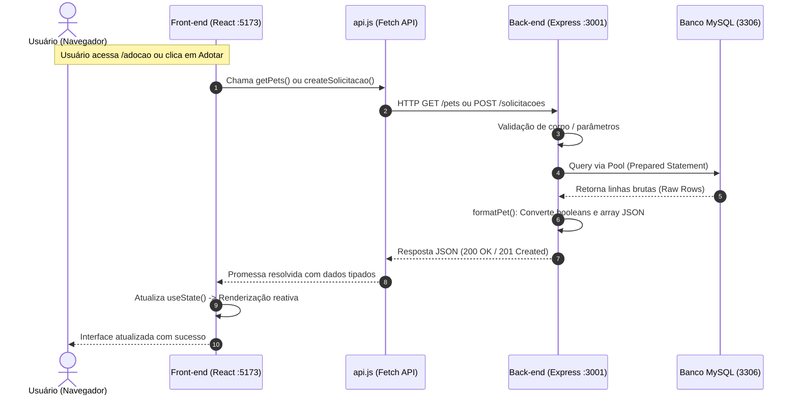

# Documento de Integração Front-end & Back-end com MySQL

Este documento explica em detalhes a arquitetura, o fluxo de dados e cada trecho crítico de código implementado para conectar a aplicação **React (Vite)** à **API REST em Node.js (Express)** e ao banco de dados relacional **MySQL (`adocao_pets`)**.

---

## 1. Visão Geral da Arquitetura

A arquitetura do sistema segue o modelo cliente-servidor desacoplado com comunicação via HTTP REST:



---

## 2. Back-end: Análise Linha por Linha (`server/server.js`)

O arquivo [server/server.js](file:///c:/Users/bruno/Desktop/progWeb/ab1/ab1-project/server/server.js) é o ponto de entrada da API. Abaixo está a análise detalhada de cada seção:

### A. Importações e Configuração de Caminho Absoluto para o `.env`

```javascript
import express from "express";
import cors from "cors";
import dotenv from "dotenv";
import path from "path";
import { fileURLToPath } from "url";
import mysql from "mysql2/promise";

const __dirname = path.dirname(fileURLToPath(import.meta.url));
dotenv.config({ path: path.resolve(__dirname, ".env") });
```

- **`fileURLToPath(import.meta.url)` & `path.dirname(...)`**: No Node.js moderno com ES Modules (`"type": "module"`), a variável global CommonJS `__dirname` não existe por padrão. Esse padrão reconstrói o caminho absoluto do diretório do script atual.
- **`dotenv.config({ path: path.resolve(__dirname, ".env") })`**: Garante que o arquivo `.env` seja encontrado e carregado corretamente mesmo que o comando de inicialização seja executado a partir da pasta raiz do projeto (`npm start --prefix server`) ou de qualquer outro diretório.
- **`mysql2/promise`**: Importa a versão baseada em `Promises` do driver MySQL, permitindo o uso nativo de `async/await` com queries não bloqueantes.

---

### B. Middlewares e Criação do Pool de Conexões

```javascript
const app = express();

app.use(cors());
app.use(express.json());

const pool = mysql.createPool({
  host: process.env.DB_HOST || "localhost",
  port: Number(process.env.DB_PORT) || 3306,
  user: process.env.DB_USER || "root",
  password: process.env.DB_PASSWORD || "",
  database: process.env.DB_NAME || "adocao_pets",
  waitForConnections: true,
  connectionLimit: 10,
  queueLimit: 0,
});
```

- **`app.use(cors())`**: Habilita o *Cross-Origin Resource Sharing*. Como o front-end roda na porta `5173` e a API na porta `3001`, o navegador bloquearia as requisições por política de mesma origem (*Same-Origin Policy*) se o cabeçalho `Access-Control-Allow-Origin` não estivesse presente.
- **`app.use(express.json())`**: Realiza o *parsing* do corpo das requisições com cabeçalho `Content-Type: application/json`, populando a propriedade `req.body`.
- **`mysql.createPool(...)`**: Cria um conjunto gerenciado de conexões reutilizáveis. Em vez de abrir e fechar uma conexão TCP a cada requisição (o que causa sobrecarga e latência), o pool empresta uma conexão pronta e a devolve após a query.
  - `connectionLimit: 10`: Limita o número máximo de conexões simultâneas para não estourar a capacidade do servidor MySQL.
  - `waitForConnections: true`: Se todas as 10 conexões estiverem ocupadas, novas requisições aguardam na fila sem lançar erro imediato.

---

### C. Normalização de Tipos de Dados: `formatPet(row)`

```javascript
function formatPet(row) {
  let temperamento = row.temperamento;

  if (typeof temperamento === "string") {
    try {
      temperamento = JSON.parse(temperamento);
    } catch {
      temperamento = [];
    }
  }

  return {
    id: Number(row.id),
    nome: row.nome,
    especie: row.especie,
    tipo: row.tipo || (row.especie?.toLowerCase().includes("gato") ? "gato" : "cachorro"),
    sexo: row.sexo || "Não informado",
    porte: row.porte || "Médio",
    idade: row.idade,
    local: row.local,
    foto: row.foto,
    descricao: row.descricao,
    vacinado: Boolean(row.vacinado),
    castrado: Boolean(row.castrado),
    vermifugado: Boolean(row.vermifugado),
    temperamento: Array.isArray(temperamento) ? temperamento : [],
    historia: row.historia || row.descricao,
    status: row.status || "disponivel",
    criado_em: row.criado_em,
  };
}
```

- **Compatibilidade do MySQL**: O MySQL armazena o tipo `BOOLEAN` como `TINYINT(1)` (valores `1` ou `0`). O método `Boolean(row.vacinado)` converte o número `1`/`0` para os valores booleanos estritos `true`/`false`, prevenindo erros de verificação no React.
- **Tratamento defensivo do JSON (`temperamento`)**: Quando a coluna `temperamento` é lida como texto, o bloco `try/catch` executa `JSON.parse`. Se a coluna já tiver sido parseada pelo driver ou contiver valor inválido, garante retorno de um array vazio `[]`, evitando quebras ao chamar `.map()` no front-end.

---

### D. Rota `GET /pets` (Listagem Completa)

```javascript
app.get("/pets", async (req, res) => {
  try {
    const [rows] = await pool.query("SELECT * FROM pets ORDER BY id ASC");
    const formattedPets = rows.map(formatPet);
    res.json(formattedPets);
  } catch (err) {
    console.error("Erro ao listar pets:", err);
    res.status(500).json({ error: "Erro ao buscar pets no banco de dados." });
  }
});
```

- **`pool.query(...)`**: Executa a consulta SQL. A desestruturação `const [rows]` descarta metadados da tabela e obtém apenas as linhas de registros.
- **`rows.map(formatPet)`**: Aplica a normalização de tipos em cada registro antes de enviar a resposta.
- **Tratamento de erro**: Responde com status HTTP `500 Internal Server Error` e um JSON explicativo caso ocorra falha de banco.

---

### E. Rota `GET /pets/:id` (Detalhes por ID com Parâmetro Seguro)

```javascript
app.get("/pets/:id", async (req, res) => {
  const { id } = req.params;
  try {
    const [rows] = await pool.query("SELECT * FROM pets WHERE id = ?", [id]);
    if (rows.length === 0) {
      return res.status(404).json({ error: "Pet não encontrado." });
    }
    res.json(formatPet(rows[0]));
  } catch (err) {
    console.error(`Erro ao buscar pet com ID ${id}:`, err);
    res.status(500).json({ error: "Erro ao consultar pet no banco de dados." });
  }
});
```

- **Query Parametrizada (`WHERE id = ?`, `[id]`)**: Protege contra **SQL Injection**. O driver compila a query separadamente dos parâmetros fornecidos pelo usuário.
- **Condicional `rows.length === 0`**: Responde com código semântico `404 Not Found` caso o ID não exista na tabela.

---

### F. Rota `POST /solicitacoes` (Registro de Adoção)

```javascript
app.post("/solicitacoes", async (req, res) => {
  const { pet_id, nome_completo, whatsapp, rotina } = req.body;

  if (!pet_id || !nome_completo?.trim() || !whatsapp?.trim() || !rotina?.trim()) {
    return res.status(400).json({
      error: "Campos obrigatórios ausentes: pet_id, nome_completo, whatsapp e rotina devem ser preenchidos.",
    });
  }

  try {
    const [pets] = await pool.query("SELECT id, nome FROM pets WHERE id = ?", [pet_id]);
    if (pets.length === 0) {
      return res.status(404).json({ error: "Pet informado não foi encontrado." });
    }

    const [result] = await pool.query(
      `INSERT INTO solicitacoes_adocao (pet_id, nome_completo, whatsapp, rotina)
       VALUES (?, ?, ?, ?)`,
      [Number(pet_id), nome_completo.trim(), whatsapp.trim(), rotina.trim()]
    );

    res.status(201).json({
      id: result.insertId,
      pet_id: Number(pet_id),
      pet_nome: pets[0].nome,
      message: `Solicitação de adoção para ${pets[0].nome} registrada com sucesso!`,
    });
  } catch (err) {
    console.error("Erro ao registrar solicitação de adoção:", err);
    res.status(500).json({ error: "Erro ao salvar solicitação no banco de dados." });
  }
});
```

- **Validação de Entrada (`400 Bad Request`)**: Verifica se todos os campos requeridos existem e não são compostos apenas por espaços em branco.
- **Integridade Referencial**: Antes de gravar a solicitação, valida se o `pet_id` existe na tabela `pets`, prevenindo quebras de chave estrangeira (*Foreign Key*).
- **Código `201 Created`**: Responde com o código de sucesso para criação de recurso, retornando o `id` gerado via `result.insertId`.

---

## 3. Front-end: Camada de Serviços HTTP (`client/src/services/api.js`)

O arquivo [client/src/services/api.js](file:///c:/Users/bruno/Desktop/progWeb/ab1/ab1-project/client/src/services/api.js) centraliza as chamadas de rede e desacopla os componentes da URL direta do servidor:

```javascript
const API_BASE_URL = import.meta.env.VITE_API_URL || 'http://localhost:3001';

export async function getPets() {
  const response = await fetch(`${API_BASE_URL}/pets`);
  if (!response.ok) {
    throw new Error(`Falha ao carregar os pets (${response.status}: ${response.statusText})`);
  }
  return response.json();
}

export async function getPetById(id) {
  const response = await fetch(`${API_BASE_URL}/pets/${id}`);
  if (!response.ok) {
    if (response.status === 404) return null;
    throw new Error(`Falha ao carregar os detalhes do pet (${response.status}: ${response.statusText})`);
  }
  return response.json();
}

export async function createSolicitacao(data) {
  const response = await fetch(`${API_BASE_URL}/solicitacoes`, {
    method: 'POST',
    headers: { 'Content-Type': 'application/json' },
    body: JSON.stringify(data),
  });

  const responseData = await response.json();
  if (!response.ok) {
    throw new Error(responseData.error || 'Erro ao registrar solicitação de adoção.');
  }
  return responseData;
}
```

- **`import.meta.env.VITE_API_URL`**: Permite mudar o endereço da API em produção criando um arquivo `.env` no cliente, mantendo `http://localhost:3001` como fallback padrão de desenvolvimento.
- **Tratamento de `!response.ok`**: A Fetch API nativa não rejeita a promessa em erros HTTP `4xx` ou `5xx`. Essa verificação converte respostas de erro em exceções tratáveis pelo `try/catch` dos componentes React.

---

## 4. Front-end: Componente `PetCard` (`client/src/components/pet-card.jsx`)

O componente [client/src/components/pet-card.jsx](file:///c:/Users/bruno/Desktop/progWeb/ab1/ab1-project/client/src/components/pet-card.jsx) implementa o formulário controlado inline:

```javascript
const [formData, setFormData] = useState({
  nome_completo: '',
  whatsapp: '',
  rotina: ''
});
const [submitting, setSubmitting] = useState(false);
const [submitStatus, setSubmitStatus] = useState('idle'); // 'idle' | 'success' | 'error'
const [errorMessage, setErrorMessage] = useState('');
```

### Manipulação de Envio e Feedback:
```javascript
const handleFormSubmit = async (e) => {
  e.preventDefault();

  setSubmitting(true);
  setSubmitStatus('idle');

  const payload = {
    pet_id: pet.id,
    nome_completo: formData.nome_completo.trim(),
    whatsapp: formData.whatsapp.trim(),
    rotina: formData.rotina.trim()
  };

  try {
    if (onSubmitForm) {
      await onSubmitForm(payload, pet.nome);
    } else {
      await createSolicitacao(payload);
    }

    setSubmitStatus('success');
    // Limpeza dos campos controlados após sucesso
    setFormData({ nome_completo: '', whatsapp: '', rotina: '' });

    // Fecha o acordeom automaticamente após 3 segundos
    setTimeout(() => {
      setSubmitStatus('idle');
      if (onToggleForm) onToggleForm(pet.id);
    }, 3000);
  } catch (err) {
    setSubmitStatus('error');
    setErrorMessage(err.message || 'Erro ao enviar a solicitação.');
  } finally {
    setSubmitting(false);
  }
};
```

- **Bloqueio durante submissão (`disabled={submitting}`)**: Impede cliques repetidos no botão antes do término da requisição.
- **Limpeza do formulário**: Zera o estado `formData` apenas se o servidor confirmar a criação (`201`), mantendo os dados preenchidos caso ocorra erro para que o usuário possa corrigir sem redigitar tudo.

---

## 5. Front-end: Consumo nas Páginas (`Catalog.jsx` e `PetDetails.jsx`)

### Padrão de Ciclo de Vida sem Vazamento de Memória

No [client/src/pages/Catalog.jsx](file:///c:/Users/bruno/Desktop/progWeb/ab1/ab1-project/client/src/pages/Catalog.jsx) e [client/src/pages/PetDetails.jsx](file:///c:/Users/bruno/Desktop/progWeb/ab1/ab1-project/client/src/pages/PetDetails.jsx), a busca de dados utiliza o padrão seguro de cancelamento com flag:

```javascript
useEffect(() => {
  let isMounted = true;

  getPets()
    .then((data) => {
      if (isMounted) {
        setPets(data);
        setError(null);
        setLoading(false);
      }
    })
    .catch((err) => {
      if (isMounted) {
        setError("Não foi possível conectar à API de pets...");
        setLoading(false);
      }
    });

  return () => {
    isMounted = false;
  };
}, []);
```

- Se o usuário navegar para outra página antes da resposta do servidor chegar, a função de limpeza (`cleanup function`) seta `isMounted = false`, evitando a advertência clássica do React: *"Can't perform a React state update on an unmounted component"*.

---

## 6. Resumo das Boas Práticas Aplicadas

1. **Segurança**: Uso estrito de queries parametrizadas (Prepared Statements) em todas as operações com parâmetros de usuário.
2. **Separação de Responsabilidades**:
   - Camada de Dados: MySQL (`adocao_pets`).
   - Camada de Negócio e API: Node.js Express (`server/`).
   - Camada de Comunicação HTTP: `client/src/services/api.js`.
   - Camada de Apresentação e Estado: Componentes e Páginas React (`client/src/`).
3. **Resiliência e UX**: Estados explícitos de carregamento (`loading`), feedback de erro (`error`) com botões de retentativa e confirmações visuais de sucesso.

